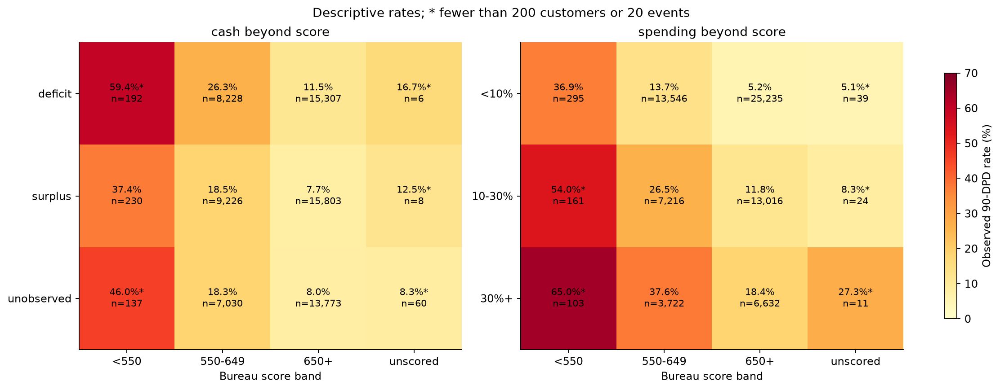
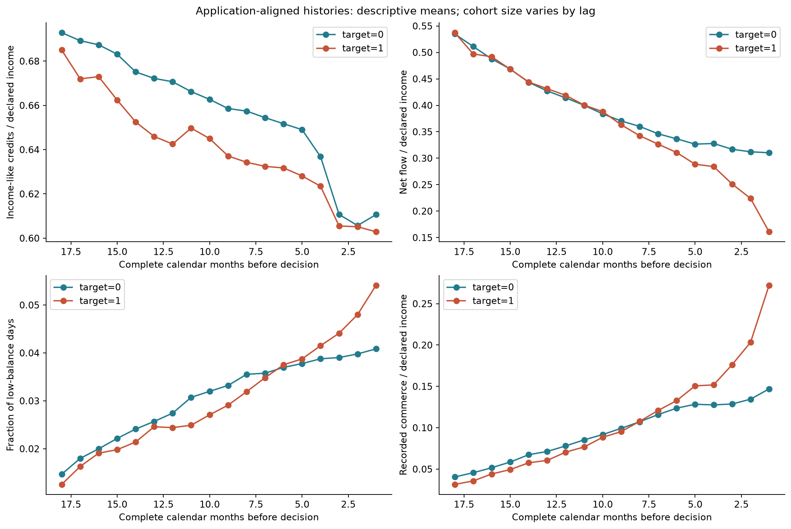
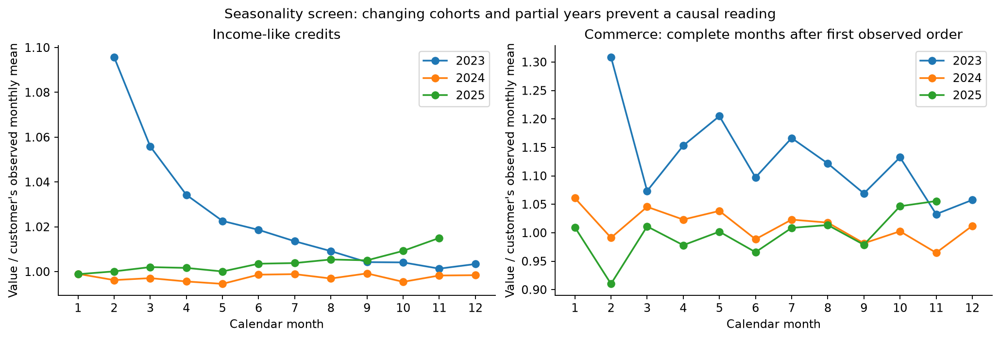
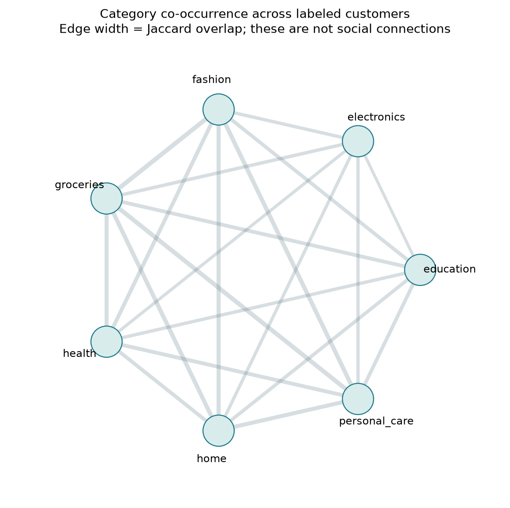
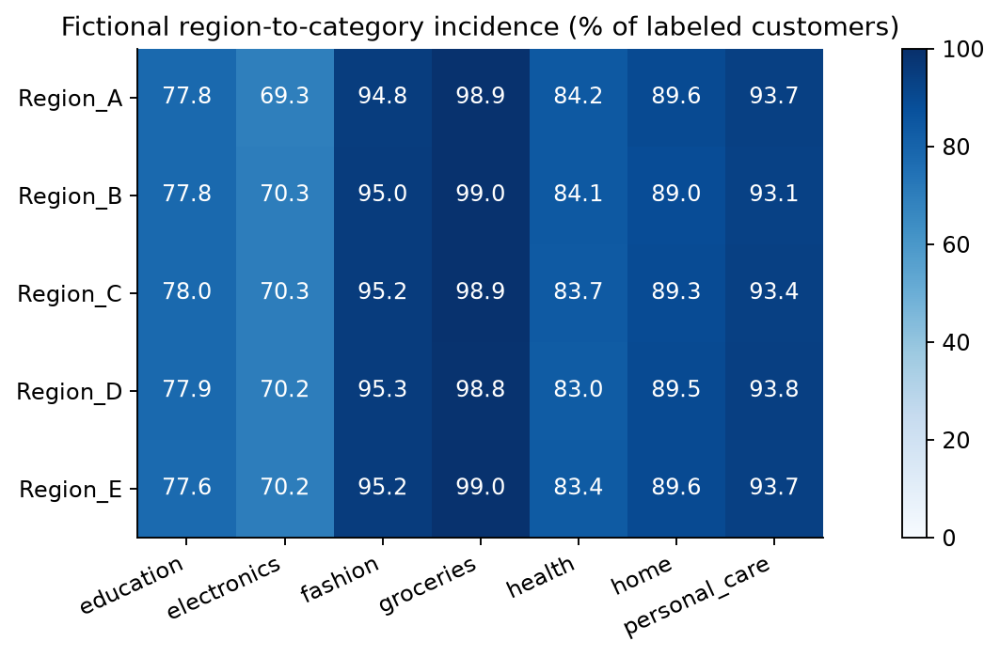

# Credit-risk exploration: behavior, timing, relationships and feature design

This extension explores all eight supplied tables using Python scripts and DuckDB. It produces 124 candidate fields for all 100,000 applications, an aligned monthly panel, category-edge data, 22 aggregate CSVs, five figures, and reproducibility/validation records. Run instructions and the output inventory are in [the script README](../../eda/risk_exploration/README.md). The original preprocessing and notebooks are unchanged.

The strongest new direction is **repayment persistence with an age-eligible denominator**, followed by **spending burden and cash-flow capacity considered together with bureau quality**. Category graphs, income cycles and bureau changes were also measured; several attractive hypotheses have weak support and should receive lower priority. No predictive model or calibrated probability was fitted.

## 1. Work backwards from the lending decision

The actual outcome is 90+ end-of-day DPD at any point within 12 calendar months. Its complement is avoiding that threshold, not necessarily paying every installment on time or repaying in full. The data describes selected originated loans, so associations apply to that selected population; they do not establish outcomes for rejected applicants. Pricing and approval policy can shape the observed relationships.

| Question a credit team needs answered | Evidence we would want | Representation supported here | Interpretation limit |
|---|---|---|---|
| Can this borrower absorb the proposed installment? | Disposable recurring income, cash buffers, existing obligations | Recent net flow less proposed installment; balance in installment units; declared/observed income comparison | Income-like credits are not verified salary; one account is not the entire household |
| Is difficulty persistent or has the customer recovered? | Longitudinal payment allocations and delinquency transitions | Ever-30-DPD share on sufficiently old dues, current arrears, cured share at cutoff | Cross-sectional installment snapshots cannot identify a full cure/relapse timeline |
| Is current spending compatible with capacity? | Spending and cash flow on the same clock | Completed spend / income; complete-month spending / outflows; spending x cash x bureau cohorts | Recorded purchases need not equal household consumption |
| Is debt demand accelerating? | Applications, inquiries, concurrent active obligations | Recent request counts, minimum request gap, rejection-to-approval pattern, scheduled-burden proxy | Historical applications do not prove desperation or concurrent live debt |
| Do external reports agree? | Provider coverage, freshness, version history, matched facilities | Latest report per provider, score dispersion, same-provider changes | Provider debts may overlap; raw scores may have different scales |
| Are concentrations or relationships driving risk? | Ownership, counterparties, households, geographic hierarchy | Customer-loan-installment ownership; customer-category incidence; fictional-region cohorts | There are no household, device, employer, merchant or geospatial identities |
| How fragile is affordability under a shock? | Income shocks, expense responses, buffers | Mechanical 10/20/30% income reductions with fixed observed outflows | This is a cash-flow sensitivity, not a forecast of PD under recession |

For a lender or credit insurer, expected loss additionally needs exposure at default and loss given default/recoveries. Neither is identified here. Loan amount multiplied by an estimated PD would not be a complete expected-loss estimate. The supplied histories also cannot establish willingness to repay, fraud, or the causal reason for a future default.

## 2. Data contracts before interpretation

The extension rechecks keys, joins, timestamps and monetary reconciliation. [Source contracts](../../outputs/04_risk_exploration/source_contracts.csv) show no duplicate previous-application IDs, originated-loan IDs, installment IDs or account customer-months; no unmatched repayment-to-owned-approved-loan links; no inconsistent order attributes or order-total/item-sum discrepancies. [Eligibility](../../outputs/04_risk_exploration/eligibility_audit.csv) confirms all 7,805,123 supplied history rows pass their respective cutoff predicates.

There are 1,084,418 complete account months. All reconcile opening balance + inflows - outflows to closing balance, and all 1,014,418 consecutive-month pairs reconcile previous closing to next opening within IDR 1. Low-balance-day counts are within their calendar month lengths. All 70,000 customers with accounts have contiguous histories, an immediately preceding complete month and 8-23 observed months. The latest three and preceding three complete months are therefore available for every observed account. Exact results are in [quality checks](../../outputs/04_risk_exploration/quality_checks.csv).

Coverage itself describes the data-generating or inclusion process. Among labeled applications:

| Observed sources | Customers | Observed 90-DPD rate |
|---|---:|---:|
| No account, prior-application or repayment history | 21,000 | 11.72% |
| Account and prior applications, no repayment history | 2,688 | 15.51% |
| Account, prior applications and repayment history | 46,312 | 14.31% |

Account and prior-application availability coincide perfectly here. They are not independent corroborating signals. Missing history must not be described as a clean repayment record or zero income. These structural links warrant a coverage-only baseline and reporting by coverage pattern. See [coverage patterns](../../outputs/04_risk_exploration/coverage_patterns.csv).

## 3. Repayment: distinguish opportunity to become late from observed behavior

For each selected cutoff, the script retains due installments on the customer's approved historical loans, excluding future due dates and any row whose last payment lies after cutoff. It calculates:

`rep_ever30_mature_share = count(max_DPD >= 30 and due_age >= 30 days) / count(due_age >= 30 days)`.

An installment due yesterday has not had 30 days to become 30 DPD. Including it as a successful negative artificially dilutes late-payment frequency. The new denominator addresses this minimum opportunity bias; it does not make every installment's observation duration identical. Older dues have more time to accrue a historical maximum, so recent/older comparisons remain exposure-duration comparisons, not reconstructed risk transitions.

| Mature ever-30 share | Labeled customers | Observed 90-DPD rate | 95% Wilson interval |
|---|---:|---:|---:|
| 0 | 11,566 | 4.36% | 4.00-4.75% |
| (0, 1/6] | 12,523 | 5.61% | 5.22-6.02% |
| (1/6, 0.375] | 10,280 | 13.05% | 12.42-13.72% |
| >0.375 | 11,410 | 34.99% | 34.12-35.87% |
| No eligible denominator | 24,221 | 12.25% | 11.84-12.67% |

Its raw class-distribution KS is **0.435**, compared with **0.371** for historical maximum DPD. The corresponding early/late decision-period values are 0.436/0.435. These are feature-distribution comparisons on different nonmissing supports, not out-of-fold prediction scores or a proven model improvement. Evidence: [bin rates](../../outputs/04_risk_exploration/bin_rates.csv) and [numeric associations](../../outputs/04_risk_exploration/numeric_associations.csv).

Current shortfall, paid/due ratio, mature shortfall, and arrears relative to available balance measure severity alongside frequency. `rep_cured_share` is the share of previously 30+ installments currently at zero DPD. `rep_adjacent_unpaid_share` describes adjacent due installments that are both unpaid at the same cutoff. Neither is a transition probability through historical calendar time. A true monthly roll-rate matrix, recovery hazard or survival target requires dated payment allocations and historical servicing snapshots, which are absent.

## 4. Capacity, liquidity and spending explain different parts of risk

The monthly liquidity representation separates flows from stocks:

- `residual_cash_ratio = (mean recent net flow - proposed installment) / mean recent income-like credits`.
- `liquidity_installments = latest closing balance / proposed installment`.
- `income_change3 = mean income in complete months 1-3 / mean income in months 4-6 - 1`, only when both windows contain three months.
- `ac_low_day_fraction = low-balance days / observed calendar days`, rather than averaging differently sized months without weights.
- Income and balance slopes use elapsed month lags; autocorrelation includes only adjacent calendar months. A missing month never becomes an observed zero or an adjacent lag.

The lowest and highest residual-cash quartiles have observed rates of **18.52% and 9.75%**. More usefully, the difference remains within bureau bands:

| Bureau score | Residual cash deficit | Residual cash surplus |
|---|---:|---:|
| 550-649 | 26.35%, n=8,228 | 18.51%, n=9,226 |
| 650+ | 11.47%, n=15,307 | 7.67%, n=15,803 |

This supports testing cash capacity as complementary to bureau quality. It does not isolate a causal income effect: score bands are coarse, and employment, prior debts, policy and source selection remain possible confounders. Existing outflows can already contain historical debt payments, so do not subtract the separate scheduled-obligation proxy again from net cash.

The spending representation deduplicates order totals, excludes cancellations from monetary spending, and uses item totals for categories. Spending burden is `completed spend in [cutoff-90d, cutoff) / (3 * declared monthly income)`. Within the 650+ bureau band, rates increase from **5.24% below 10% burden** to **11.78% at 10-30%** and **18.35% above 30%**. Within 550-649, those rates are **13.69%, 26.47%, 37.61%**. It is an association with recorded spending, not evidence that shopping causes default.

The three-way view is more informative than either isolated gradient: among 650+ scores, low spending burden plus cash surplus has **5.03%** observed risk (n=10,215), versus **19.55%** for high spending burden plus cash deficit (n=3,207). See [three-way cells](../../outputs/04_risk_exploration/three_way_risk.csv), including separate early/late periods.

In the mechanical 20% income reduction, holding outflows and the proposed installment fixed, the deficit share rises from **48.07% to 59.30%** among account-observed salaried customers, **47.28% to 59.03%** for self-employed customers, and **50.77% to 62.15%** for variable-income customers. This ranks cash fragility under the stated arithmetic, not expected default or claim frequency. [Stress scenarios](../../outputs/04_risk_exploration/stress_scenarios.csv) include 0/10/20/30% shocks.

A plausible story did fail its first screen: recent income decline is weakly associated with the label (raw KS **0.025**), and the largest income-growth quartile has higher observed risk than the largest-decline quartile (**15.26% versus 13.73%**). Variable-income customers with >20% increases also have higher descriptive risk than those with >20% decreases. Income-like credits may include timing shifts, irregular business receipts or other funds. Do not encode a monotonic "income decline means higher risk" assumption from domain intuition alone. See [employment interactions](../../outputs/04_risk_exploration/interactions.csv).

## 5. Timeline design and the difference between cycles and observation artifacts

There are three distinct clocks: calendar month, time before decision, and time since a historical loan/installment event. The script preserves all three rather than treating row order as time. Account windows use `month_lag` from the decision's calendar-month boundary. For an April 15 decision, January-March are the last three complete months. This avoids the old script's rolling-date condition, which can omit January and leave only two months. The original script is preserved; this extension supplies the corrected construction.

The lag chart compares different customers as history length grows, so it cannot establish an individual's deterioration path. `lag_profiles.csv` supplies counts at every lag. A later longitudinal model should restrict a balanced cohort or explicitly model observation exposure.

Calendar month/weekday sine-cosine pairs and purchase recurrence measurements are implemented as exploratory candidates. Recurrence includes inter-order-gap mean/CV, the share of gaps within 6-8 and 27-33 days, weekday concentration, month-end share, and night share. These thresholds are descriptive choices, not inferred salary schedules. Recurrence depends on order intensity and history length; compare it with `ec_gap_support`, counts, and observed span before interpreting it as a routine. There are no daily cash-credit timestamps with which to align purchases to payday.

The seasonality screen first normalizes by each customer's observed mean. Zero-filling all account months before their first recorded commerce event can manufacture growth: the naive monthly spending ratios span **0.070-1.483**. The corrected screen restricts commerce to complete months after the first observed order and renormalizes on that support; the range becomes **0.910-1.309**. Both versions and support counts are retained in [seasonality](../../outputs/04_risk_exploration/seasonality.csv). Some early cells have only ten supported observations, so even the corrected extrema are not strong evidence of seasonality. This is an observation sensitivity, not proof that the first order is the true account-opening date. The account panel supplies no actual commerce enrollment or extraction-start date.

There are **4,415 customers** with fewer than 180 days between first recorded commerce event and decision. A 90-versus-prior-90 spending ratio can mix behavior with left truncation; retain observed-span and denominator-zero flags, and test >=180-day support as a sensitivity. A null ratio from zero prior spending is distinct from zero growth. Calendar effects should only be promoted if they repeat across years on matched support and survive decision-period checks. No externally supplied holidays, geography or macroeconomic series were joined.

## 6. Graphs: use actual edges and test whether their structure adds information

The [relationship inventory](../../outputs/04_risk_exploration/relationship_inventory.csv) contains:

- 159,323 originated loans owned by 66,519 customers; each loan has a unique owner.
- 1,361,341 installments on 155,901 of those loans.
- 608,454 customer-category edges connecting 100,000 customers to only seven categories.
- 100,000 customer-region edges to five fictional regions.

Customer-loan-installment graphs are useful for lineage and exposure aggregation, but their ownership stars do not establish borrower-to-borrower contagion. Common category, region, provider or employment type is a cohort affiliation, not proof of a household or social relationship. There are no coordinates for a geographic distance map. Do not attempt to identify these fictional places.

For the category projection, edge Jaccard overlap ranges from **0.585 to 0.941**, but co-occurrence lift relative to independent category participation is only **0.9995-1.0015**. Most customers touch five to seven categories (10th-90th percentiles). The apparent dense network therefore largely reflects ubiquitous categories. Category entropy has raw KS **0.0075**, degree **0.0164**, and concentration/HHI **0.0077**. These results give little support to a graph neural network or community-risk feature at this stage.

Region is still useful for monitoring concentration, source coverage and conditional calibration. Raw rates range from **12.91% in Region_E to 14.25% in Region_D**. Standardizing every region to the training population's bureau-score-band mix gives **12.90% and 14.28%**, respectively. This coarse adjustment does not explain the gap; nor does it establish geography as its cause. The unscored regional strata contain only 12-18 customers, so these standardized rates are descriptive. The [region/employment/score cells](../../outputs/04_risk_exploration/geographic_cohorts.csv) support further checks.

If a future graph experiment is justified, construct a training-only reference graph with eligible historical edges, remove the query customer's contribution from peer statistics, and map validation/test customers inductively. Do not propagate target rates across the combined train/test graph or use future customers to define earlier communities. Global category co-occurrence and region rates in this report are EDA outputs, not application features.

## 7. Bureau disagreement and lending history

Bureau records have both a report clock and an availability clock. Eligibility requires both at/before cutoff; latest selection is per provider by availability, report time, then opaque ID solely as a deterministic tie-breaker. Changes are computed only within the same provider, with strictly increasing report time and elapsed-day normalization. The schema lacks revision lineage, so backdated corrections cannot be treated as a clean economic trajectory.

Same-provider score changes are observed for **69.24%** of labeled customers. Their raw KS is **0.045**, versus **0.253** for the latest mean score; utilization change is **0.010** and score dispersion **0.013**. The score-change quartiles are not monotone in risk. Keep freshness, provider support and coverage beside these candidates; do not assume every disagreement is hidden debt or a sudden deterioration.

For **81,228 customers**, adding latest provider balances yields more than taking the maximum. This is arithmetic evidence that aggregation choice matters, not proof of exact overlap. Without matched facility identifiers, summing can count the same facility several times; taking the maximum can omit distinct facilities. `bu_debt_sum_overlap_bound` is retained for sensitivity diagnostics only and is not a certified upper bound on actual total debt, especially with stale/incomplete reports. `bu_debt_max` is a conservative observed-debt proxy, not household debt.

Prior applications yield 90-day request counts, rejection share, shortest request gap and observed rejection-to-approval changes. The scheduled-active proxy uses prior decision date plus contractual tenor to approximate remaining obligations. Actual origination dates, closures, refinancings and prepayments are unavailable. Treat it as a sensitivity feature, not a verified debt-service ratio. Raw pricing and decision-delay features can reflect prior underwriting policy, and require separate ablations.

## 8. Prioritized preprocessing plan

All listed candidates were implemented for inspection; "priority" specifies what to promote into a subsequent training recipe, not a claim of predictive gain. Exact formulas live in [timeline SQL](../../eda/risk_exploration/sql/01_timelines.sql) and [commerce/cross-table SQL](../../eda/risk_exploration/sql/02_commerce.sql). [Feature inventory](../../outputs/04_risk_exploration/feature_inventory.csv) records every column's type, missingness and cardinality.

| Priority | Candidate family / examples | Evidence and intended explanation | Construction and acceptance gate |
|---|---|---|---|
| P0 | Source-presence and exposure support | Coverage groups have different rates; 30% lack accounts | Preserve missing/observed-zero distinction; add explicit source flags, keep history lengths; coverage-only baseline |
| P1 | `rep_ever30_mature_share`, mature due count, shortfall, current/max DPD | Strong age-eligible frequency gradient, stable early/late separation | Keep minimum opportunity denominators and support; compare models on identical customers; assess thin repayment histories |
| P1 | `residual_cash_ratio`, `liquidity_installments`, low-balance fraction | Capacity differences remain within score bands | Complete-month windows; positive-denominator checks; do not double-subtract debt or commerce from outflows |
| P1 | `ec_spend30/90`, `spend_income90`, recent counts | Spending burden differs within score and cash strata | Order grain, completed status, observable-window flags; test recurrence independent of frequency |
| P1 | Bureau snapshot plus debt/income | Strong score gradient with supplementary capacity information | Latest available report per provider; never sum overlapping facilities as verified debt |
| P1 | Cross-table interactions | 5.03% versus 19.55% in well-supported three-way cells | Let trees test interactions or predeclare simple products; no target-rate columns in features |
| P2 | Income/net-flow change, slopes, autocorrelation | Feasible calendar histories, weak/nonmonotone income-change association | Minimum paired windows, support flags, no monotonic constraint justified; test within employment groups |
| P2 | Same-provider bureau changes | Some repeated-report support but weak raw separation | No cross-provider temporal differences; reject invalid elapsed times; sensitivity to freshness |
| P2 | Request bursts, decision sequences, scheduled burden | Potential debt-demand/policy context | Separate policy and behavior ablations; scheduled burden is a proxy with uncertain live-loan status |
| P2 | Cancellation, payment method, gap variation | May describe friction and routine; category meaning is ambiguous | Keep cancellation value out of spend; adjust for event counts and recording span |
| P3 | Calendar cyclic encodings and gap-cycle shares | Cycles are feasible to calculate, not yet demonstrated | Balanced support, repeated annual pattern and temporal holdout stability before promotion |
| P3 | Category degree/entropy/HHI, cohort graph features | Near-independent category edges and weak separation | Keep simple summaries for ablation; no costly graph model without incremental evidence |
| Diagnostic | Ledger residuals, continuity, missing-month count, latest lag, support counts constant here | Exact accounting and complete panel observed | Retain in monitoring outputs; remove constant/redundant features from training |
| Diagnostic | Region, demographic slices, income shocks, provider sum | Useful cohort review and sensitivity | Regional rates and stress percentages are reports, never direct calibrated PD estimates |

Model-input policy:

1. Drop `application_id`, `customer_id`, `target`, `split`, `application_datetime`, and `decision_datetime` from predictors; keep them in the audit manifest. Drop constant `term_months` and constant/redundant diagnostics. Missingness of a constant-with-null field can duplicate the account-presence indicator.
2. Retain null continuous measurements when a source or denominator is absent. A genuinely observed zero completed-spend window is zero. Add denominator-zero and support flags before any imputation. Do not replace null bureau utilization with zero utilization.
3. Review negative balances and net flow as economically meaningful. Do not clip valid utilization >1 automatically. Fit any quantile clipping, category mapping, rare-level pooling, scaler, or imputer on a training fold only. Use signed transforms for net cash if a later model requires scaling.
4. Encode low-cardinality categories using fold-compatible native categorical support or a fixed documented vocabulary. Fit peer baselines and category rarity on training references only, ideally using earlier feature vintages. Any supervised target encoding must be out of fold and label-maturity aware.
5. Keep source blocks removable. Start with the existing baseline, then add mature repayment, cash capacity, normalized commerce, temporal changes, and graph summaries one family at a time. Compare raw and income-normalized spending, and include runs excluding lender pricing and decision-delay signals.
6. Accept a family only on consistent held-out improvement with paired uncertainty and stable coverage/period results. More columns, a compelling business story, or a larger raw-feature KS is insufficient.

## 9. Validation, explanation and limits of inference

`validate.py` passes hand-calculable fixtures through the actual feature SQL. Its 12 recorded checks cover strict event cutoffs, inclusive bureau availability, complete-month boundaries, future-payment quarantine, gap-aware lags, short-window handling, order deduplication, cancelled spending, item-level categories, absent histories, invariance of every candidate to label mutation, and full-data grain/split preservation. See [validation](../../outputs/04_risk_exploration/validation.json).

The analysis reports descriptive Wilson intervals for application-level rates, plus a minimum-support flag (n>=200 and >=20 events). These are nominal intervals, not simultaneous corrections for searching many features. Raw-feature KS is computed on observed values separately for January-September and October-December; train/test KS uses unlabeled feature distributions only. The early/late split is a retrospective stability screen. It is not prospective training: a 12-month target for early-2025 loans is not fully mature by late 2025. `decision + 12 months` in the manifest is explicitly a maturity proxy, since exact selected-loan origination and target-availability timestamps are absent.

All training labels have now been explored, so selecting a new holdout from them does not make it untouched evidence. Subsequent fold results remain development estimates and can be optimistic after feature selection. Use nested selection or a frozen recipe and genuinely independent outcomes for a stronger claim. Hidden test labels were never used. No test-target rates were inferred.

For a future model, retain KS as the competition metric, then examine calibration/Brier/log loss and observed versus predicted rates by coverage, region, employment and affordability. Compare candidates on exactly the same folds and customers; bootstrap at customer level, not installment or monthly-row level. With repeated customers in future data, use group splits and timestamped snapshots. The current build deliberately rejects that changed grain.

An explanation should link a model contribution to auditable observations: "recent net cash after the proposed installment was negative in the available account" or "X of Y sufficiently old installments previously reached 30 DPD." Keep observation date, source completeness, formula and support with each explanation. Feature attribution may explain the model's score; it cannot prove why the borrower will default. Do not translate medical-purpose or health-category purchases into a diagnosis, or broad location into an individual causal claim.

## 10. Data that would unlock stronger questions

These are institution-side data requirements for future work, not external datasets to add to this competition.

| Desired insight | Missing data contract | What becomes possible |
|---|---|---|
| True payday stress and payment scheduling | Timestamped credits/debits, verified recurring source, due schedule, ingestion timestamp | Cash-at-due-date, days between payroll and installment, daily liquidity troughs |
| Deterioration and cure/relapse | Payment allocations, reversals, daily DPD snapshots and correction versions | Roll rates, arrears duration, recurrent delinquency and recovery trajectories |
| Actual household obligations | Facility IDs, ownership/co-borrower roles, balances, closures and minimum payments | Deduplicated debt service and borrower/household exposure graphs |
| Local or employer concentration | Authorized stable employer/counterparty IDs, explicit geographic hierarchy with snapshot dates | Real concentration networks and held-out community stress checks |
| Distinguish inactivity from missing capture | Source enrollment, observation start/end, consent and outage periods | Exposure-adjusted event rates and defensible zero filling |
| Insurance/lending loss severity | Origination, utilization, recoveries, collateral, costs, claim terms | PD/LGD/EAD decomposition and loss sensitivity |
| Policy-versus-customer effects | Decision-policy version, offer/acceptance history and eligible applicant population | Policy-shift checks; better treatment of selection into originated loans |

Methodological context only: [BCBS 239](https://www.bis.org/publ/bcbs239.pdf) motivates accurate, complete, timely risk aggregation and explicit lineage; it is not claimed as a compliance certification for this competition. A [CFPB cash-flow analysis](https://www.consumerfinance.gov/archive/blog/credit-scores-only-tells-part-of-the-story-cashflow-data/) motivates checking cash-flow indicators within score groups. Its US evidence does not establish transfer to these Indonesian records. Neither source contributed data or feature values; every numerical finding above comes from the supplied competition tables.
