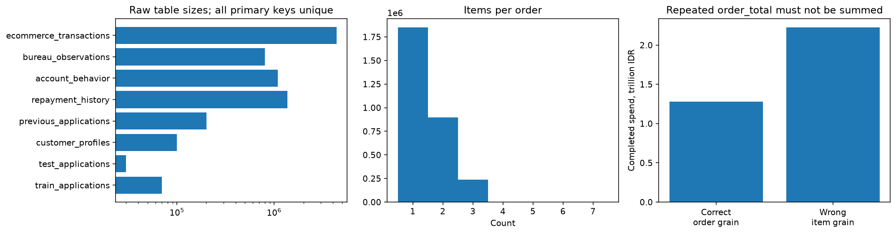
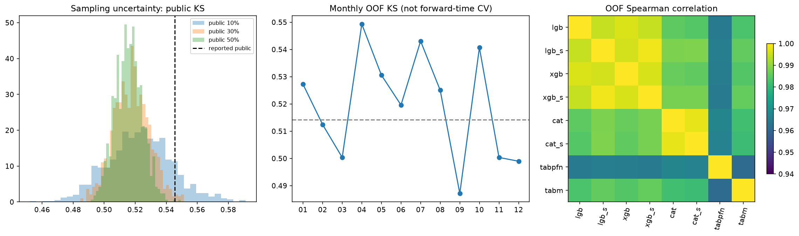
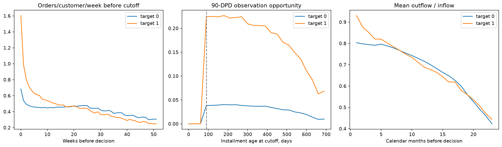
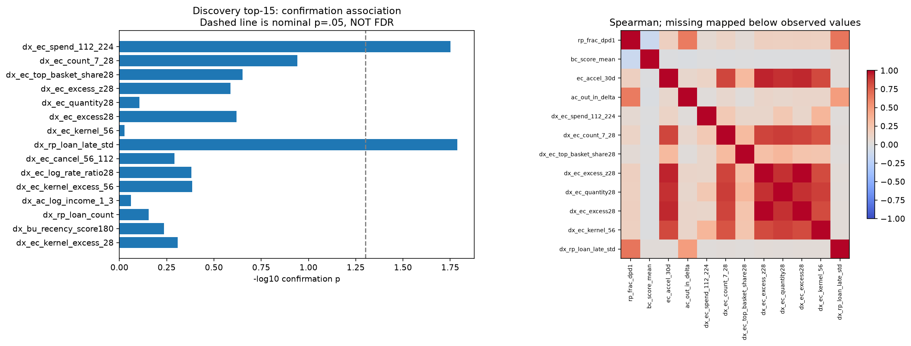
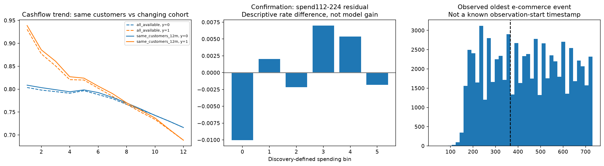
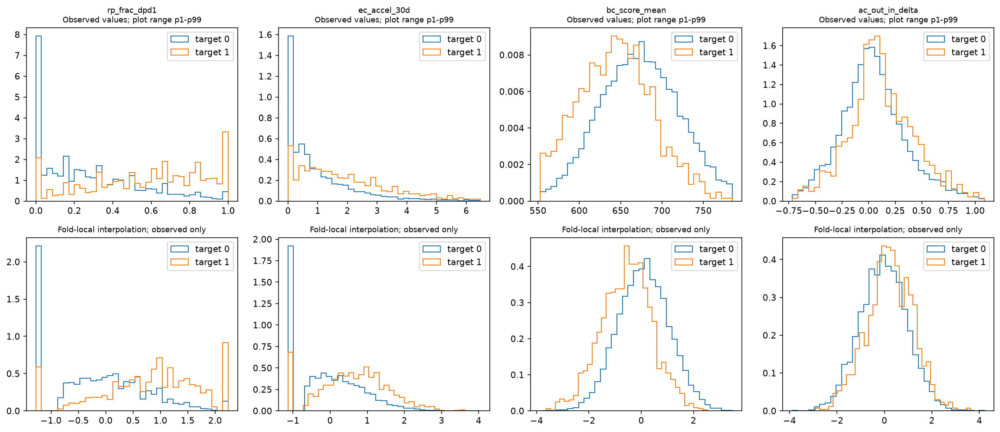
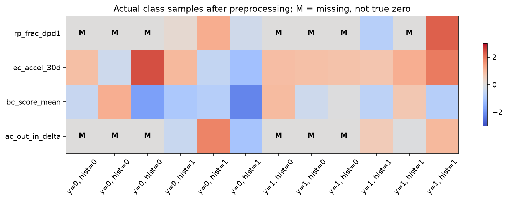
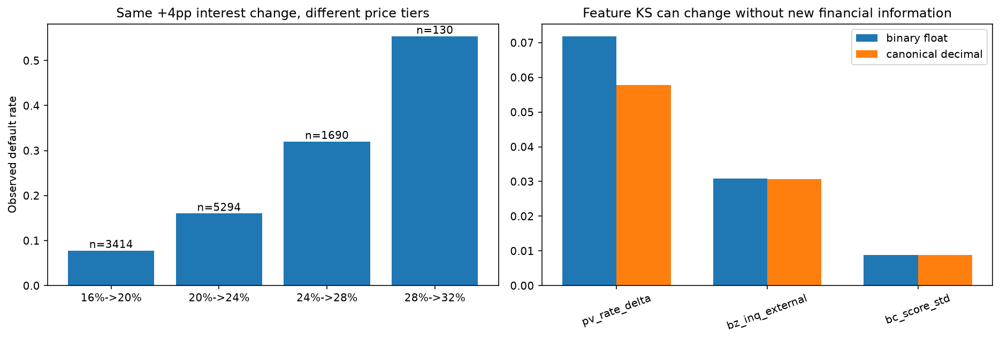
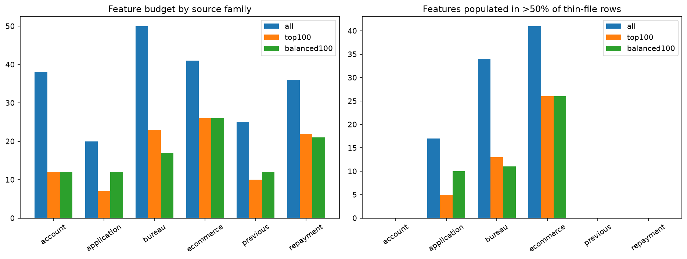
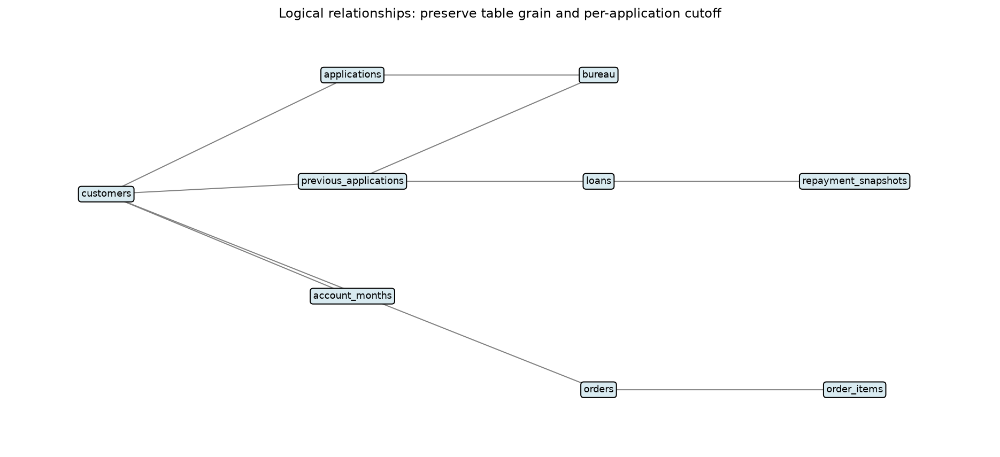

# Hasil deep EDA LOGIKA

Tanggal analisis: 13 Oktober 2026. Public v3 **0,54545** berasal dari pengguna; tidak diambil atau diverifikasi melalui akun Kaggle. Angka lain di bawah dihitung dari data dan artefak lokal. Seluruh sembilan tahap EDA/preprocessing dijalankan; semua sebelas grafik diperiksa secara visual.

## Keputusan

Belum ada bukti bahwa mengganti model atau menambah puluhan fitur akan menghasilkan lonjakan KS besar. Pipeline lama sudah menangkap banyak sinyal utama. Hasil yang layak dibawa ke eksperimen remote berikutnya adalah:

1. **Validasi preprocessing per fold**, bukan fit distribusi pada seluruh train sebelum CV.
2. **Ablation representasi numerik**, termasuk transisi bunga eksplisit; jangan menyamakan preservasi angka floating point dengan preservasi informasi ekonomi.
3. **Satu kandidat utama: spending completed 112–224 hari sebelum keputusan**, diuji terpisah dari fitur lainnya.
4. **Ablation feature budget FM**, kemudian jalur relasional dengan cutoff yang benar. Belum ada model baru yang dinyatakan menang.

Tidak ada notebook atau submission baru.

## 1. Struktur, identitas, dan duplikasi

Ada 70.000 train, 30.000 test, 9.507 label positif train (13,58%). Customer unik dan tidak berulang antarkedua split. Seluruh primary key yang diperiksa unik; tidak ditemukan customer orphan atau baris melewati cutoff yang relevan. Loan repayment selalu terhubung ke historical application, dan bureau application ID selalu berada pada namespace aplikasi selected/historical.

Tidak ditemukan duplikat exact pada seluruh feature row, atau profile identik yang melintasi train/test. Ini tidak membuktikan ketiadaan semua bentuk near-duplicate.

**Dua operasi deduplikasi yang berbeda:**

- `order_total` diulang per item: penjumlahan naïf mengubah completed spending dari **1,2805 triliun** menjadi **2,2276 triliun IDR**, faktor **1,7396×**. Aggregate sekali per `order_id`.
- Ada **2.388 item** yang identik jika `order_item_id` dibuang. Menghapusnya merusak **1.194 order**, sementara sebelum dihapus jumlah `item_total` tepat sama dengan `order_total`. Pertahankan item dengan ID berbeda.

Pipeline v3 sudah memakai grain order yang benar; audit ini mencegah regresi preprocessing, bukan menemukan bug spending v3.

## 2. KS dan perbedaan public/private

| Prediksi tersimpan | KS OOF |
|---|---:|
| Blend v2 | 0,513474 |
| Blend v3 | 0,514227 |
| TabM v3 | 0,512593 |
| LightGBM v3 | 0,511756 |
| Equal-weight trees v3 | 0,510544 |
| TabPFN v3 | 0,499524 |

V3 minus v2 = **+0,000753**. Paired stratified bootstrap 1.000 iterasi, dengan prediksi/bobot tetap: interval 95% sekitar **−0,00212 sampai +0,00406**. Ini belum mencakup variasi retraining atau adaptive model selection.

KS v3 pada thin-file **0,476767**, history **0,527930**. TabM sendiri pada thin-file **0,481071**. Performa segmen berbeda dan bobot yang bagus di satu segmen belum tentu memberi ranking global terbaik.

Simulasi 30.000 baris test dari OOF, tanpa replacement, 1.000 pengulangan per skenario:

| Public share asumsi | Baris public | Median KS public | Interval persentil 2,5–97,5% | Fraksi simulasi KS >= 0,54545 |
|---|---:|---:|---:|---:|
| 10% | 3.000 | 0,52313 | 0,48409–0,56631 | 12,6% |
| 30% | 9.000 | 0,51768 | 0,49526–0,54110 | 1,1% |
| 50% | 15.000 | 0,51560 | 0,49924–0,53264 | 0,2% |

**Bobot public/private 45%/45% dalam rules bukan jumlah baris public/private.** Skor 0,54545 justru di atas OOF; frekuensi simulasi tidak boleh dibaca sebagai probabilitas private tertentu. Dataset test bisa berbeda dan averaging model test berbeda dari OOF.

KS bulanan 0,487–0,549 hanyalah evaluasi subset dari random-fold OOF, bukan forward-time validation. Maximum feature PSI sekitar 0,00116: marginal drift kecil, bukan bukti pasti conditional target distribution sama.

Official KS dua sisi tetap dipakai. Formula `max(tpr-fpr)` dari teks pengguna hanya ekuivalen untuk arah ranking yang sesuai; ia bukan definisi umum KS dua sisi. Script memeriksa signed KS juga agar skor terbalik tidak dianggap model baik.

## 3. Pola waktu dan 79 kandidat

Kandidat yang benar-benar dihitung mencakup count/spending/cancel pada interval tidak overlap, baseline-adjusted burst, kernel recency, partial/unpaid rates, DPD maturity, agregasi per loan, calendar-month cashflow shock, recency-weighted bureau dan dua interaksi lintas sumber.

Temuan visual:

- Jumlah order/customer/minggu terakhir: sekitar **1,603 pada bad vs 0,684 pada good**. Aktivitas menyimpang paling jelas menjelang keputusan; agregasi lifetime mencampur baseline dan burst.
- Cicilan berumur di bawah 90 hari memang belum berkesempatan mencapai 90 DPD. Denominator maturity-aware adalah hipotesis sah, tetapi mengurangi banyak observasi dan **belum memberi incremental evidence kuat**.
- Cashflow ratio bad meningkat dekat keputusan. Pola tetap terlihat pada **36.660 customer yang sama dengan 12 bulan histori lengkap**, jadi tidak semata-mata akibat customer berbeda di setiap bulan.
- Hanya **62,22%** customer train memiliki oldest e-commerce event setidaknya 365 hari sebelum keputusan. Oldest event bukan metadata awal observasi: nol transaksi lama bisa berarti tidak belanja atau belum teramati.
- Plot minggu terakhir semula mencakup week 52 yang hanya satu hari karena batas 365 hari. Plot diperbaiki untuk menampilkan minggu lengkap, agar penurunan palsu tidak dibaca sebagai perilaku.

Semua kandidat lolos injeksi baris masa depan: hasil fitur tetap sama. Sum item/order dan jumlah transaksi pada interval tidak overlap juga dikonservasi.

## 4. Hasil residual: jangan menambah fitur hanya karena KS marginal besar

Ada **289 fitur numerik** yang diperiksa: 210 lama + 79 kandidat baru. Strata terdiri dari 30 kelompok ranking v3 x status history. Binning fitur ditentukan pada discovery 35.001 baris; confirmation berisi 34.999 baris. Digunakan generalized stratified contingency test, koreksi Benjamini–Hochberg, sensitivitas 10/30/60 risk bins, serta restricted permutations untuk kandidat teratas.

Sebagian fitur bagus secara marginal tetapi sudah redundan dengan v3. Contoh kernel excess 28 hari memiliki validation signed KS sekitar **0,313**, tetapi p residual confirmation **0,491**.

**Spending 112–224 hari** adalah satu-satunya nominee yang lolos discovery FDR di antara 289 tes:

- Discovery p sekitar **0,000160**, q **0,04624**.
- Confirmation p **0,01771**.
- Dengan observed-history-span quintile tambahan, confirmation p **0,01677**.
- Risk bins 10/30/60 memberi confirmation p **0,01165 / 0,01771 / 0,01965**.
- Restricted permutation 99 pengulangan menghasilkan p **0,02**.

Ada dua keputusan multiplicity yang sengaja dilaporkan terpisah:

- Jika semua 289 confirmation tests dikoreksi sekaligus, **tidak ada yang lolos**.
- Jika hanya satu nominee discovery-FDR diteruskan, confirmation keluarga terpilih adalah **0,01771**.

Protokol kedua memberi alasan eksploratif memprioritaskan satu fitur ini, bukan bukti final. Protokol tersebut dicatat sebagai follow-up setelah screening, dan OOF v3/label sudah dipakai sebelumnya. Jangan mengubahnya menjadi klaim fresh-holdout significance.

Hubungan conditional tidak monoton: kelompok spending terendah mempunyai default sekitar 1 percentage point lebih rendah dibanding risk strata-nya, sementara beberapa kelompok menengah lebih tinggi. **Jangan langsung menambahkan rank fitur dengan bobot positif tetap ke submission.** Dibutuhkan ablation model remote pada fold yang sama.

## 5. Preprocessing: apa yang berhasil dan apa yang perlu hati-hati

Diuji pada lima validation fold, fit hanya di training fold:

| Transformasi | Maksimum perubahan absolut KS fitur observed |
|---|---:|
| ECDF bertangga + Gaussian + float32 | 0,000501 |
| ECDF interpolated + Gaussian + float32 | 0,000000 pada pemeriksaan ini |
| Robust scaling + asinh + float32 | 0,032861 |

Interpolated ECDF mempertahankan KS observed yang diukur, finite output, kategori, dan pemisahan missing melalui indikator. Ia tetap dapat menyatukan out-of-range values dan bukan bukti bahwa trained-model KS meningkat.

138 kolom memiliki missing, dengan 29 pola missing yang sama pada training; pengelompokan ini tidak pecah di validation/test pada lima fold. Artefak alternatif memakai indikator per kolom untuk tidak mengasumsikan pola identik selalu bertahan. Pembedaan **tidak punya histori** vs **punya histori dengan nilai nol** tetap dipertahankan.

Sampel dari kedua kelas dan kedua kelompok history disimpan sebagai CSV dan heatmap. Missing bernilai numerik 0 setelah imputasi tetap mempunyai flag sendiri. Distribusi kelas sesudah transformasi diperiksa; tidak diterapkan rotation/jitter/SMOTE karena tidak ada dasar semantik untuk augmentasi itu pada fitur keuangan ini.

## 6. Iterasi setelah menemukan masalah presisi

Perubahan 0,032861 di atas terutama muncul pada `pv_rate_delta`. Ada 17 nilai binary-float observed yang sesungguhnya hanya sembilan selisih bunga ekonomis.

Contoh selisih +4 percentage points:

| Transisi bunga | N | Bad rate |
|---|---:|---:|
| 16% -> 20% | 3.414 | 7,79% |
| 20% -> 24% | 5.294 | 16,02% |
| 24% -> 28% | 1.690 | 32,01% |
| 28% -> 32% | 130 | 55,38% |

Nilai float `0.03999999999999998`, `0.04000000000000001`, dan `0.040000000000000036` secara tidak sengaja membedakan sebagian parent price tier. Ini **bukan bukti target leakage**; parent interest rates sudah merupakan fitur yang sah. Namun preservasi setiap bit float bisa menguatkan sinyal tersembunyi yang bergantung implementasi aritmetika.

Follow-up menghasilkan view terpisah:

- Bulatkan `pv_rate_delta`, `bz_inq_external`, dan `bc_score_std` pada delapan desimal.
- Pertahankan parent rates dan tambah kategori `rate_transition`.
- Fit ulang interpolated preprocessing di fold yang sama; KS observed untuk tiga fitur semantik tidak berubah setelah transformasi.
- Raw view tetap tersedia sebagai pembanding.

KS marginal delta bunga seluruh train turun dari 0,07184 menjadi 0,05781 setelah pembulatan. **Turun tidak otomatis berarti preprocessing salah**, sama seperti mempertahankan KS float tidak otomatis berarti preprocessing paling baik. Bandingkan kedua view dalam model remote; jangan menyimpulkan robust scaling selalu buruk dari satu fitur.

## 7. Feature budget dan foundation models

Audit top100 fold pertama memberikan 22 repayment, 12 account, 10 previous, 23 bureau, 26 e-commerce, dan tujuh application features. Hanya **44 dari 100 numerik** populated pada mayoritas thin-file rows, dibanding 92 dari 210 pada full view. Ini tidak membuktikan selection menjadi penyebab utama kekalahan FM; ia memberi ablation yang terukur.

Disediakan all/top100/family-balanced100, **dipilih pada train fold masing-masing**. Family-balanced bukan hasil tuning terbaik. V3 sudah menggunakan full training context untuk TabPFN; menaikkan context lagi saja bukan diagnosis yang cukup.

| Model | Implikasi persiapan/eksperimen |
|---|---|
| TabPFN-Rel | DFS + TabPFN-3.5. Audit relasi dan per-application cutoff lebih dulu; jangan copy task forecasting benchmark begitu saja. |
| TabPFN-3.5 | Bandingkan feature views sambil menahan fold/context tetap; jangan mengganti preprocessing, fitur, dan context bersamaan. |
| Causilo | Native mixed types/NaN dan opsi KV cache; cache adalah tradeoff memori/waktu, bukan bukti KS meningkat. |
| EXAONE Tabular | 21M parameter tidak menentukan kebutuhan context memory. Remote CUDA planner menyediakan budget byte eksplisit. |
| Mitra-v2 | Bedakan stock default dan published fine-tuning/bagging recipe; hasil benchmark bukan estimasi KS LOGIKA. |
| RT-PluRel | System relational benchmark; implementasi cutoff/snapshot dan adaptasi task mendahului benchmarking. |

Sumber primer yang dicek: [TabPFN-Rel](https://github.com/PriorLabs/tabpfn-rel), [TabPFN](https://github.com/PriorLabs/TabPFN), [Causilo](https://github.com/nums-ai/causilo), [EXAONE](https://github.com/LGAI-Research/EXAONE-Tabular), [Mitra-v2](https://huggingface.co/autogluon/mitra-classifier-2), [RelArena](https://github.com/PriorLabs/relarena).

Tidak ada model dipasang/dijalankan, tidak ada data dikirim ke hosted API. Rules melarang external datasets; status setiap pretrained weight/API tidak dijelaskan eksplisit dalam salinan rules, jadi jangan menganggap semua otomatis disetujui.

## 8. Ekspor relasional dan kecocokan task

Sepuluh tabel diekspor, 12 foreign-key relationship diperiksa, dan label train dipisahkan. `orders` dan `order_items` dipisah supaya total order tidak dijumlahkan pada grain item.

Waktu ketersediaan:

- Bureau: `available_datetime`, bukan hanya `report_datetime`.
- Account month: awal bulan berikutnya.
- Previous application: historical decision.
- E-commerce: transaction event.
- Repayment/profiles: **snapshot pada selected decision**, bukan state yang boleh dimundurkan ke due date.

Dokumentasi [RPI task definition](https://github.com/PriorLabs/relarena/blob/main/docs/predictive-task.md) mendefinisikan label dari forward-window query dan pembagian phase timestamp. LOGIKA sudah memberikan satu label per aplikasi, cutoff per customer, dan train/test interleaved. Dataset tidak menyediakan outcome history untuk membangun ulang target sesuka hati. Karena itu, ekspor ini **belum merupakan TabPFN-Rel adapter yang siap fit**; future remote integration harus mempertahankan label resmi dan per-query masking, tanpa merekonstruksi label test.

## 9. Batas akhir kerja lokal

Semua kandidat/transformasi di atas sudah diperiksa sampai titik di mana pemeriksaan data tanpa model masih dapat memberi bukti. Melanjutkan pemilihan transformasi berdasarkan trained-model KS akan memerlukan eksperimen remote, di luar instruksi lokal saat ini.

Urutan ablation remote yang dibenarkan oleh hasil ini: baseline fold-safe yang sama -> satu fitur spending112–224 -> semantic preprocessing/price transition -> controlled FM feature views -> adapter relational yang lulus cutoff tests. Ukur KS model/paired delta/segmen pada fold yang sama, lalu nilai kontribusi OOF ensemble. Jangan mengubah semuanya sekaligus dan mengatribusikan gain kepada preprocessing.

**Private KS, model KS setelah preprocessing baru, dan pemenang keenam FM belum diketahui.** Tidak ada janji skor, batas maksimum dataset, atau klaim SOTA baru.
